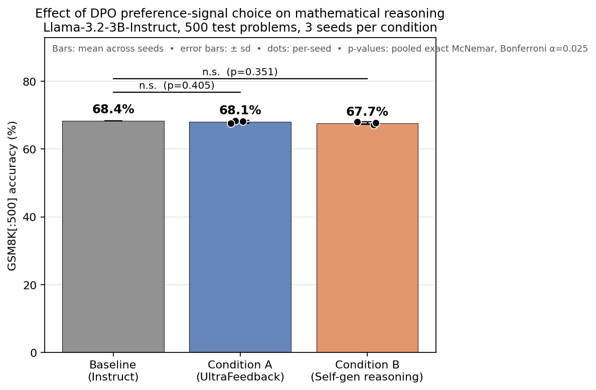

# DPO Reasoning Transfer

**When does preference optimization transfer to specialized mathematical reasoning?**
*A preference-signal ablation on Llama-3.2-3B-Instruct.*

<!-- Author: replace with your name / affiliation / contact -->
> **Author:** {{Abbas Sani}} · {{INTELLICODE SYSTEMS}} · {{https://github.com/avvas200}}

---

## TL;DR

Direct Preference Optimization (DPO) has become the default post-training recipe for aligning language models to human preferences. It reliably improves chat quality; its effect on *specialized capabilities* like mathematical reasoning is less clear. Prior work documents an "alignment tax" in which alignment training on general-purpose preference data degrades or fails to improve capability-benchmark performance. The natural follow-up question is whether the tax is intrinsic to DPO at small scale, or specific to the *preference signal being general-purpose*.

This project isolates the preference signal as the sole variable. We fix the base model (Llama-3.2-3B-Instruct in 4-bit), the LoRA configuration (r=16), the DPO recipe (β=0.1, lr=5e-6, 500 pairs, 1 epoch), and the evaluation protocol (GSM8K test[:500], greedy decoding, strict match), and vary only the preference source across two conditions:

- **Condition A** — `HuggingFaceH4/ultrafeedback_binarized` (general-purpose chat preferences, the community-standard DPO data).
- **Condition B** — self-generated preference pairs, where `chosen` and `rejected` are correct and incorrect chains-of-thought sampled from the base model on GSM8K *train* problems.

Three seeds per condition. Pre-registered statistical tests (McNemar exact per-seed, pooled McNemar with Bonferroni α=0.025, paired-bootstrap CIs). Mechanistic follow-up on the trained LoRA adapters (per-token KL divergence vs. base, per-module Frobenius weight-norm audit, discordant-problem structural coding).

**Headline findings** (n = 500 test problems, 3 seeds each; 95% CIs from paired bootstrap):

| Condition | Preference source | Accuracy (mean ± sd) | Δ vs baseline | Pooled McNemar p | Decision |
|---|---|---|---|---|---|
| Baseline | — | 68.4% (342/500) | — | — | — |
| A | UltraFeedback (500 pairs) | 68.1% ± 0.4 pp | −0.3 pp | 0.405 | H1 supported (null replicated) |
| B | Self-generated reasoning (500 pairs) | 67.7% ± 0.4 pp | −0.7 pp | 0.351 | H2 **not** supported |

**In one line:** neither preference source moved GSM8K accuracy at this scale, but the *mechanism* underneath the shared null differs — Condition A leaves 81% of greedy-decoded responses byte-identical to baseline, while Condition B actually changes 59% of them and their effects roughly cancel (13 rescues vs. 17 breaks, ~40% of which are extraction artifacts rather than reasoning changes). The pre-registered decision rule for H2 (mean Δ ≥ +3 pp, pooled p < 0.025, all per-seed CIs excluding zero) fails on all three criteria; the mechanistic profile is consistent with 500-pair outcome-verified DPO acting as diffuse regularization rather than reasoning-quality signal at this model scale.



Full write-up in [REPORT.md](REPORT.md). Full pre-registered protocol in [RESEARCH_PLAN.md](RESEARCH_PLAN.md).

---

## What's actually in this repo

This is a small empirical study executed at T4-class compute (Colab free-tier). The claim is not state-of-the-art anything — it is a clean, pre-registered ablation with honest statistics and a mechanistic follow-up. What makes it worth reading is the *design discipline*, not the numbers:

- **Pre-registered decision rules.** `RESEARCH_PLAN.md` §4 commits to specific thresholds (mean Δ ≥ +3 pp, pooled p < 0.025, all per-seed CIs excluding zero) *before* any DPO run finishes. The decision function is code in `src/stats.py`; no post-hoc goalpost-moving is possible. In this run both hypotheses' decisions matched what the code said the day it was written: H1 supported, H2 not supported.
- **A shared training driver.** `src/train.py` defines one `DEFAULT_DPO_HPARAMS` dict that both DPO notebooks read from. The two conditions cannot silently diverge on hyperparameters.
- **Resumable everything.** Every long-running loop (eval, preference sampling, DPO training) checkpoints to Google Drive and picks up cleanly from Colab session drops.
- **Mechanistic layer, not just accuracy.** Notebook 06 characterizes *what changed inside the model* (per-token KL vs. base, per-module Frobenius weight-norm audit, discordant-problem structural coding), so the report says more than "accuracy went from X to Y." In this study specifically, the mechanistic layer is what makes the shared null informative rather than uninformative — it shows the two conditions are producing the same accuracy through fundamentally different behavioral profiles.

---

## Repository structure

```
dpo-reasoning-transfer/
├── README.md                    # this file
├── REPORT.md                    # the write-up (cite from SOP)
├── RESEARCH_PLAN.md             # pre-registered protocol
├── requirements.txt
├── src/
│   ├── eval.py                  # resumable GSM8K eval loop
│   ├── prefs.py                 # preference set construction + DPO formatting
│   ├── train.py                 # shared DPO training + LoRA driver
│   └── stats.py                 # McNemar, bootstrap, Cochran's Q, H1/H2 decisions
├── notebooks/
│   ├── 01_baseline_eval.ipynb
│   ├── 02_build_reasoning_prefs.ipynb
│   ├── 03_dpo_A_ultrafeedback.ipynb   # seed-parameterized, run 3×
│   ├── 04_dpo_B_reasoning.ipynb       # seed-parameterized, run 3×
│   ├── 05_statistics_and_figures.ipynb
│   └── 06_mechanistic_analysis.ipynb
├── data/                        # populated by Notebook 02
├── results/                     # populated by Notebooks 01, 03, 04, 05
│   ├── baseline_gsm8k_500.json
│   ├── dpo_{A,B}_seed{1,2,3}.json
│   ├── aggregated_stats.json
│   ├── mechanistic_stats.json
│   └── figures/
└── adapters/                    # populated by Notebooks 03, 04 (used by 06)
```

---

## Reproducing the results

Everything runs on Colab free-tier T4 (16 GB VRAM). Total wall-clock is ~16 hours across ~5 focused sessions.

**Setup (one-time).**
1. Create a folder on your Google Drive called `dpo-reasoning-transfer/`.
2. Upload the `src/` folder to `Drive/dpo-reasoning-transfer/src/` (or clone this repo into Drive after step 3).
3. Open each notebook in Colab, set **Runtime → Change runtime type → T4 GPU**.

**Run in order.** Each notebook is idempotent — completed steps are cached to Drive and re-runs are cheap. Approximate wall-clock:

| Notebook | Purpose | Runtime |
|---|---|---|
| `01_baseline_eval` | Base model on GSM8K[:500] | ~1.5 h (once) |
| `02_build_reasoning_prefs` | Sample & pair CoTs for Condition B | ~3 h (once) |
| `03_dpo_A_ultrafeedback` | Condition A, seeds 1, 2, 3 | ~2 h × 3 |
| `04_dpo_B_reasoning` | Condition B, seeds 1, 2, 3 | ~2 h × 3 |
| `05_statistics_and_figures` | Pooled analysis + headline figure | ~2 min (CPU) |
| `06_mechanistic_analysis` | KL, weight norms, discordant coding | ~15 min |

The DPO notebooks (03, 04) are seed-parameterized: edit `SEED = 1` at the top, run all cells, then change to `SEED = 2`, re-run from the model-load cell onward, then `SEED = 3`. Each seeded run saves both its evaluation JSON and its trained LoRA adapter to Drive.

**Colab session survival.** If Colab drops mid-run:
- The eval loop resumes from the last completed problem (per-problem JSONL checkpoints).
- The preference-sampling loop resumes from the last processed problem.
- DPO training does not resume mid-training — but on re-run, if the eval JSON exists for that seed, the notebook skips retraining entirely.

The RESEARCH_PLAN's §12 risk register documents other failure modes.

---

## Honest limitations

Named up-front, discussed in REPORT.md §7:

- **Single base-model family and size.** Results at 3B do not necessarily generalize to 7B, 70B, or other model families.
- **Single benchmark family.** GSM8K captures elementary-arithmetic reasoning. MATH-500, MMLU-STEM, or Big-Bench Hard would tell a fuller story; excluded here for compute reasons.
- **500 preference pairs per condition.** Small by DPO-literature standards. Larger preference sets might change the picture — this study cannot distinguish "signal absent" from "signal present but under-powered."
- **Final-answer verifier only.** Condition B's "correct" chains can contain broken reasoning that lands on the right number by chance. Process supervision (Lightman et al. 2024) is a more expensive but principled alternative, noted as future work.
- **Extractor confound.** The strict-last-number answer extractor is sensitive to trailing-numeric response formatting; ~40% of Condition B's discordant activity is attributable to formatting shifts rather than reasoning changes. This does not affect the aggregate accuracy statistics (the effect is roughly symmetric) but it is documented in REPORT.md §6.3 as a caveat on the discordant counts.
- **T4-scale.** Every choice in this project — quantization, batch size, LoRA rank, preference set size — was constrained by fitting into Colab free-tier's 16 GB VRAM and ~4h session limit. The scientific findings are honest at that scale; extrapolating to larger scales is future work.

---

## Citation

If this study or its infrastructure is useful to you (edit the fields to match your actual details):

```bibtex
@misc{yourkey2026dporeasoning,
  author = {Abbas Sani},
  title  = {When does preference optimization transfer to reasoning?
            A preference-signal ablation on Llama-3.2-3B},
  year   = {2026},
  howpublished = {\url{https://github.com/avvas200/dpo-reasoning-transfer}},
  note   = {Colab free-tier reproducible pipeline}
}
```

---

## Acknowledgments

Base model: [`unsloth/Llama-3.2-3B-Instruct`](https://huggingface.co/unsloth/Llama-3.2-3B-Instruct) (Meta AI, quantized by the Unsloth team).
DPO implementation: [TRL](https://github.com/huggingface/trl) (HuggingFace).
Efficient QLoRA training on T4: [Unsloth](https://github.com/unslothai/unsloth).
Preference data (Condition A): [`HuggingFaceH4/ultrafeedback_binarized`](https://huggingface.co/datasets/HuggingFaceH4/ultrafeedback_binarized).
Benchmark: [GSM8K](https://huggingface.co/datasets/openai/gsm8k) (OpenAI).
