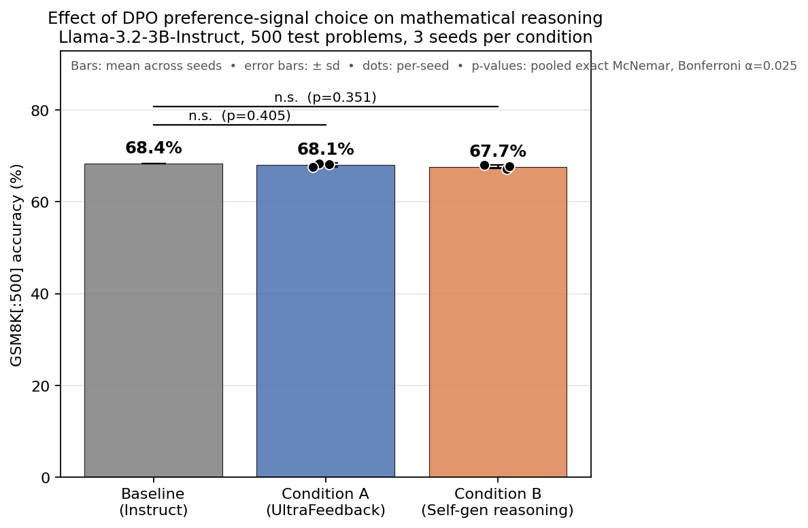
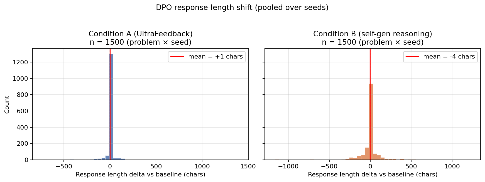
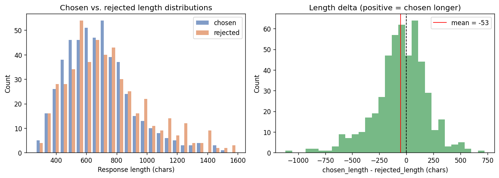
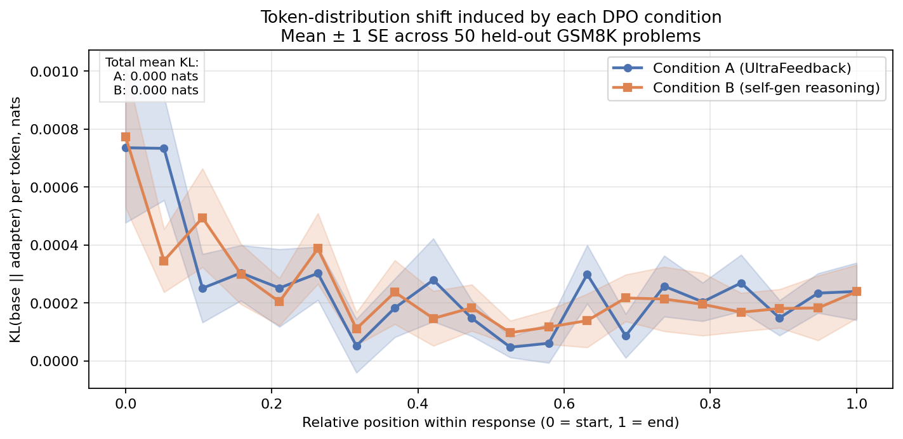
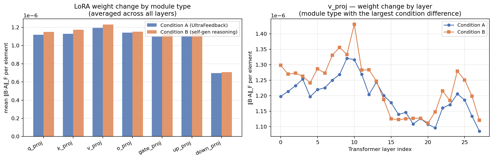
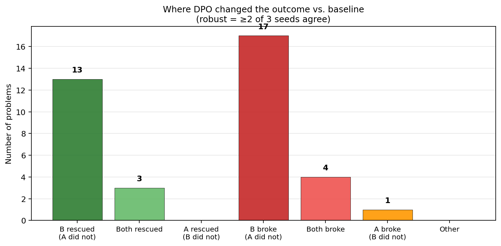

# When does preference optimization transfer to reasoning?
## A preference-signal ablation on Llama-3.2-3B-Instruct

<!-- Fill in with your name, affiliation, email. -->
**{{YOUR NAME}}**
*{{AFFILIATION}}*
*{{EMAIL}}*

*Repository:* [https://github.com/{{YOUR_GH}}/dpo-reasoning-transfer](https://github.com/{{YOUR_GH}}/dpo-reasoning-transfer)
*Version:* {{VERSION}} · *Date:* {{DATE}}

---

## Abstract

Direct Preference Optimization [Rafailov et al., 2023] has become the default recipe for post-training language models. Its effect on specialized capabilities like mathematical reasoning is less clear: prior work documents an "alignment tax" [Askell et al., 2021; Ouyang et al., 2022] in which alignment training on general-purpose preferences degrades or fails to improve capability-benchmark performance. Whether this tax is intrinsic to DPO at small scale or specific to the *preference signal being general-purpose* is an open question. We hold the base model (Llama-3.2-3B-Instruct in 4-bit), the LoRA configuration, DPO hyperparameters (β = 0.1, lr = 5×10⁻⁶), evaluation protocol, and preference-set size (500 pairs) fixed, and vary a single factor: the source of the preference pairs. Condition A uses `HuggingFaceH4/ultrafeedback_binarized`; Condition B uses self-generated preference pairs where the *chosen* and *rejected* chains-of-thought are correct and incorrect completions sampled from the base model on GSM8K training problems. Evaluated on 500 GSM8K test problems across three seeds per condition with a pre-registered statistical protocol (exact McNemar per seed, pooled McNemar with Bonferroni α = 0.025, paired-bootstrap CIs), we find that **neither condition moves accuracy: Condition A yields a mean Δ of −0.3 pp (pooled McNemar p = 0.405) and Condition B yields −0.7 pp (pooled p = 0.351), and no per-seed 95% bootstrap CI excludes zero**. Mechanistic analysis of the trained LoRA adapters — per-token KL divergence from the base model and per-module Frobenius weight-norm audit — shows **that the two conditions produce nearly identical mean per-token KL from base (≈2.5×10⁻⁴ nats/token both), despite Condition B applying ≈2.4% larger LoRA weight updates and changing the response text on 59% of problem×seed cells versus 19% for Condition A**. The study demonstrates that at T4-class compute, **swapping the preference source from general chat to self-generated reasoning pairs is not, by itself, enough to move small-scale DPO past the alignment-tax null on GSM8K; the mechanistic profile is consistent with outcome-verified pairwise preferences at this size acting as diffuse regularization rather than as a reasoning-quality signal**.

---

## 1. Introduction

Direct Preference Optimization [DPO; Rafailov et al., 2023] fits a language model to a dataset of pairwise (chosen, rejected) response comparisons by optimizing an implicit reward derived from the model's own log-probabilities. It has largely replaced the more expensive PPO-based RLHF pipeline as the community-default post-training method, and is empirically effective at improving conversational quality on chat benchmarks such as MT-Bench and AlpacaEval [Tunstall et al., 2023].

Whether the same recipe improves *specialized capabilities* — mathematical reasoning, coding, factual recall — is less well established. A body of prior work documents an "alignment tax" in which alignment training on general-purpose human preferences either leaves capability benchmarks unchanged or degrades them [Askell et al., 2021; Ouyang et al., 2022]. The tax was originally documented for RLHF, but similar patterns appear in DPO studies at small scale.

An important ambiguity in this literature is whether the tax is a property of *the alignment method* (DPO, PPO) or *the alignment signal* (which preferences are being fit). Most published studies vary the method and hold the preference source constant (typically UltraFeedback or an equivalent general-purpose set), which makes the two factors difficult to separate. This paper reverses the pattern: we hold the method and hyperparameters fixed and ablate the preference source.

### 1.1 Contribution

Our central question is: **under what conditions does preference optimization transfer to specialized mathematical reasoning?** We do not treat "the alignment tax on reasoning" as a fixed property of DPO, but as a function of the preference signal being optimized against, and we ablate that signal while holding everything else constant.

Three concrete contributions:

1. **A clean preference-signal ablation.** Two DPO conditions differ *only* in preference source: 500 pairs from `HuggingFaceH4/ultrafeedback_binarized` (general-purpose chat preferences) vs. 500 pairs of correct-vs-incorrect chains-of-thought self-generated from the base model on GSM8K training problems. Model, LoRA config, hyperparameters, dataset size, and evaluation are byte-identical.

2. **A pre-registered statistical protocol.** McNemar per seed, pooled McNemar with Bonferroni correction across the two condition-vs-baseline families, paired-bootstrap CIs, and — most importantly — a specific pre-registered decision rule for whether "Condition B improves reasoning" (mean Δ ≥ +3 pp, pooled p < 0.025, and every per-seed 95% CI excludes zero). The decision function is code committed to before any DPO run finishes, published in the repository, and cannot be modified after seeing results.

3. **Mechanistic characterization.** Three probes on the trained LoRA adapters — per-token KL divergence from the base model averaged over held-out GSM8K problems, per-module Frobenius weight-norm audit, and discordant-problem structural coding — showing not just *whether* the two conditions differ in outcome accuracy but *what changes inside the model* to produce (or fail to produce) any difference.

### 1.2 Scope and honesty

This is a small empirical study. The base model is 3B parameters. The training set for either DPO condition is 500 pairs. The evaluation is 500 GSM8K test problems. The training and analysis run on Colab free-tier T4 in ~16 hours of total wall-clock. We do not claim state-of-the-art results and we do not extrapolate to model scales we did not test. What we do claim is that the design is clean, the statistics are honest, and the mechanistic follow-up is informative — and that the ablation answers a well-posed question at the scale it was executed.

---

## 2. Related work

**Preference optimization.** DPO [Rafailov et al., 2023] optimizes a closed-form objective derived from the Bradley-Terry model of preference, with the reference model providing regularization via the β hyperparameter. It has become the default DPO recipe in open-source post-training pipelines including Zephyr [Tunstall et al., 2023] and forms the foundation of many subsequent methods. Prior to DPO, RLHF [Christiano et al., 2017; Ouyang et al., 2022] achieved similar objectives via PPO training against an explicit reward model.

**The alignment tax.** The observation that alignment training can degrade base-model capabilities appears in the InstructGPT paper [Ouyang et al., 2022] and is discussed conceptually in Askell et al. [2021]. Empirical work has documented the effect on various benchmarks; the magnitude and direction depend on the base model, the preference data, and the specific capability tested.

**Self-generated preference data.** STaR [Zelikman et al., 2022] and ReST [Gulcehre et al., 2023] use model-self-generated correct and incorrect solutions as training signal. Our Condition B is a small-scale, DPO-adapted instance of this pattern: rather than filter for correct traces and continue training (STaR) or iteratively bootstrap (ReST), we construct pairwise (correct, incorrect) preferences and apply standard DPO. The design choice foregoes the process-level supervision available in some alternatives in favor of comparability with Condition A.

**Process-level verification.** Lightman et al. [2024] argue that step-level (process) supervision substantially outperforms outcome-level (final-answer) supervision for mathematical reasoning. Our Condition B uses outcome-level verification only — a chain is "correct" if and only if its final extracted number matches ground truth — and thus admits chains that arrive at the right answer through broken reasoning ("spurious correctness"). We treat process supervision as a natural extension and discuss it in §7.

**Efficient training.** LoRA [Hu et al., 2021] and its 4-bit quantized variant QLoRA [Dettmers et al., 2023] enable single-GPU fine-tuning of 3B–7B models on consumer hardware. We use QLoRA via the Unsloth implementation, which makes DPO training of Llama-3.2-3B feasible on Colab T4.

---

## 3. Method

### 3.1 Base model and infrastructure

We use `unsloth/Llama-3.2-3B-Instruct` loaded in 4-bit NF4 quantization. All training and evaluation runs on a single Colab free-tier T4 (16 GB VRAM). LoRA adapters attach at rank r = 16 with α = 16 to the standard Llama attention and MLP targets (`q_proj`, `k_proj`, `v_proj`, `o_proj`, `gate_proj`, `up_proj`, `down_proj`). The base weights are frozen throughout; only LoRA parameters are updated.

For DPO, the reference model is the frozen base with adapters disabled — Unsloth's QLoRA-DPO shortcut, which avoids loading a second model instance.

### 3.2 Preference data conditions

Both conditions have identical size (500 pairs), identical prompt template, and identical DPO hyperparameters. They differ only in preference source.

**Condition A (control) — general-purpose preferences.** `HuggingFaceH4/ultrafeedback_binarized`, `train_prefs` split, shuffled with a seed and truncated to 500 pairs. This is the community-standard DPO dataset used in the original Zephyr recipe.

**Condition B (treatment) — self-generated reasoning preferences.** Constructed as follows:

1. Sample K = 4 chains-of-thought per problem from the base model on GSM8K *train* (temperature 0.8, top-p 0.95, max 384 new tokens) for up to 700 problems.
2. Extract the final numeric answer from each chain via the same strict-match rule used at evaluation.
3. Retain problems where at least one chain matches the ground truth answer AND at least one chain does not. At the base model's ~60% training-set accuracy, this yields a usable pair with probability 1 − 0.6⁴ − 0.4⁴ ≈ 0.85 per source problem (verified by simulation and empirically achieved after processing 1500 source problems).
4. `chosen` is uniformly random from the correct chains; `rejected` is uniformly random from the incorrect chains. We deliberately do *not* bias toward "shortest correct / longest incorrect" pairs — that would introduce an anti-length signal that would confound the reasoning-signal hypothesis.
5. Save 500 pairs to disk with full audit metadata (all K predicted answers, per-response lengths, which sample indices were chosen).

The resulting mean chosen-vs-rejected length delta is **−53 characters** (i.e. chosen chains are on average 53 characters *shorter* than rejected chains — see §5.4 and Figure 2 for the full distribution). This residual signal is a natural byproduct of the base model producing longer chains when it goes off track (extra re-attempts, self-correction), and we characterize it in the report but do not attempt to remove it. Sampling is exclusively from GSM8K train; the 500 test problems used for evaluation are never seen during preference construction.

An important limitation of this construction: a chain labeled "correct" may contain broken reasoning that arrives at the right final number by coincidence. Final-answer verification is a coarser signal than step-level (process) supervision. We discuss this in §7.

### 3.3 DPO training

Both conditions use the same recipe: β = 0.1, learning rate 5 × 10⁻⁶, one epoch, effective batch size 8 (per-device batch size 2 × gradient accumulation 4), linear LR schedule with 10% warmup, AdamW-8bit optimizer, `max_length` = 1024, `max_prompt_length` = 512. Training uses bf16 when supported (the T4 falls back to fp16). A single DPO run takes ~30 minutes on T4.

The three seeds vary (a) LoRA initialization, (b) DPO trainer's data-order and minibatch composition, and (c) for Condition A, which 500-pair subset of UltraFeedback is used (`.shuffle(seed=SEED).select(range(500))`). Condition B has a fixed 500-pair pool that all three seeds see in shuffled orders.

### 3.4 Evaluation

The evaluation benchmark is GSM8K test[:500] — the first 500 problems of the standard GSM8K test split — held identical across every run so paired statistical tests are valid. We use a one-shot user turn ("Solve this problem step by step. End your response with the final numeric answer."), greedy decoding, max 512 new tokens. Answer extraction is by the strict last-number convention with light numeric normalization (`18.0` matches `18`, `1,234` matches `1234`).

For each problem, the eval loop caches `(question, ground_truth, predicted_answer, full_response, correct_flag)`. All seven eval JSONs (baseline + 3 seeds × 2 conditions) live in `results/`; every number in this report traces back to those files.

---

## 4. Statistical protocol

The following analyses were committed to before any DPO run finished (see `RESEARCH_PLAN.md` §4, timestamped in the repository history):

1. **Primary per-seed test.** Exact McNemar on discordant pairs between each seeded condition and baseline. α = 0.05.

2. **Pooled test.** McNemar on discordant pairs summed across all three seeds within a condition. Complemented by Cochran's Q on the joint (baseline + 3 seeds × 2 conditions) matrix as a sanity check.

3. **Effect size.** Paired difference in accuracy with 95% percentile bootstrap CI, 10,000 resamples of the 500 problems.

4. **Multiple comparisons.** Two condition-vs-baseline families → Bonferroni-adjusted α = 0.025 on the pooled tests.

5. **H2 decision rule.** Condition B is judged to have improved reasoning iff *all three* of the following hold:
   - Mean Δ across seeds ≥ +3.0 percentage points.
   - Pooled McNemar p < 0.025 (Bonferroni-adjusted).
   - Every per-seed 95% bootstrap CI excludes zero.

The rule is implemented as `stats.decide_h2()` in `src/stats.py`. Anything weaker is reported honestly as "trend but not conclusive."

**H1 decision rule (null-result replication for Condition A).** H1 is judged supported iff |mean Δ| < 2.0 pp AND pooled McNemar p > 0.05.

---

## 5. Results

### 5.1 Baseline

Baseline `Llama-3.2-3B-Instruct` on GSM8K test[:500]: **68.4%** (342/500). Mean response length 670 characters. No output-extraction failures (the extractor returned `None` on 0/500 problems).

### 5.2 Aggregated results

Table 1 summarizes the pooled results across three seeds per condition.

**Table 1.** Aggregated results on GSM8K test[:500].

| Condition | Mean acc | sd (across 3 seeds) | Mean Δ vs baseline (pp) | Pooled McNemar p | Bonferroni-adjusted decision |
|---|---|---|---|---|---|
| A (UltraFeedback) | 68.1% | 0.4 pp | −0.3 | 0.405 | n.s. |
| B (Self-gen reasoning) | 67.7% | 0.4 pp | −0.7 | 0.351 | n.s. |

The per-seed detail (Table 2) shows the seed-to-seed variability that motivates aggregation.

**Table 2.** Per-seed detail. `b` and `c` are the McNemar discordant-pair counts (b = baseline right, DPO wrong; c = baseline wrong, DPO right). CIs are 95% paired-bootstrap over 500 problems.

| Condition | Seed | Accuracy | Δ (pp) | 95% CI (pp) | b | c | McNemar p |
|---|---|---|---|---|---|---|---|
| A | 1 | 68.2% | −0.2 | [−1.2, +0.6] | 3 | 2 | 1.000 |
| A | 2 | 68.4% | 0.0 | [−1.4, +1.4] | 6 | 6 | 1.000 |
| A | 3 | 67.6% | −0.8 | [−1.8, 0.0] | 5 | 1 | 0.219 |
| B | 1 | 68.0% | −0.4 | [−2.8, +2.0] | 20 | 18 | 0.871 |
| B | 2 | 67.2% | −1.2 | [−3.4, +1.2] | 21 | 15 | 0.405 |
| B | 3 | 67.8% | −0.6 | [−3.0, +2.0] | 22 | 19 | 0.755 |

Cochran's Q across baseline + all six seeded runs: Q = 2.16, df = 6, p = 0.904. The joint hypothesis "all seven runs share the same per-problem correctness distribution" is not rejected.

### 5.3 Pre-registered hypothesis decisions

**H1 (null-result replication for Condition A). Supported.** Mean |Δ_A| = 0.3 pp (threshold < 2.0 pp: ✓); pooled McNemar p_A = 0.405 (threshold > 0.05: ✓). The alignment-tax null observed in the preliminary experiment replicates cleanly at n = 500 × 3 seeds.

**H2 (Condition B improves reasoning). Not supported.** All three criteria fail:
- Mean Δ_B ≥ +3.0 pp: **FAIL** (observed −0.7 pp).
- Pooled McNemar p_B < 0.025: **FAIL** (observed 0.351).
- Every per-seed 95% CI excludes zero: **FAIL** (all three CIs include zero — see Table 2).

*Figure 1. GSM8K accuracy for baseline vs. Condition A (UltraFeedback, 500 pairs) vs. Condition B (self-generated reasoning preferences, 500 pairs). Bars are the mean across three seeds; error bars are ± sd; dots are individual seeds. Pooled McNemar p-values (exact, two-tailed) are annotated with Bonferroni-adjusted significance markers at α = 0.025. Neither condition reaches significance; both point estimates are marginally below baseline.*

### 5.4 Response length audit

DPO can inflate or deflate response length; if either condition shifts length substantially, some of the accuracy movement could be attributable to a length effect rather than reasoning quality. Table 3 characterizes the paired shift.

**Table 3.** Response length shift vs. baseline, pooled across three seeds per condition (n = 1500 problem×seed cells each).

| Condition | Mean Δ length (chars) | Median Δ | sd Δ | n longer / shorter / same |
|---|---|---|---|---|
| A | +0.8 | 0 | 72.2 | 120 / 148 / 1232 |
| B | −4.3 | 0 | 133.2 | 398 / 465 / 637 |

*Figure 2. Distribution of paired response-length changes vs. baseline, pooled over three seeds per condition. Vertical dashed line at zero (no change), red solid line at the mean. Condition A produces a byte-identical response on 82% of cells; Condition B produces a byte-identical response on 41% of cells but averages a −4-character shift.*

Two observations worth flagging. First, **Condition A leaves the response byte-identical to baseline on 1216/1500 (81.1%) of problem×seed cells** — meaning that under greedy decoding, on four problems in five the trained adapter has no observable effect on the generated text at all. This is a much stronger form of "null result" than the accuracy number alone conveys. Second, Condition B is *not* a no-op — it changes the response on 884/1500 (58.9%) cells — but the changes cancel out in aggregate, producing a similar accuracy to Condition A through a fundamentally different mechanism: many small perturbations that hurt and help in roughly equal measure (see §6.3).

The preference-data length audit for Condition B is shown in Figure 6 for completeness.

*Figure 6. Response lengths of `chosen` (correct) and `rejected` (incorrect) chains in the Condition B preference set. Mean length difference = −53 characters (chosen slightly shorter than rejected), a residual anti-length signal that arises because the base model tends to produce longer chains when its reasoning goes off track.*

---

## 6. Mechanistic analysis

Accuracy alone tells us whether a condition helped; it does not tell us *what changed inside the model*. Three probes on the trained LoRA adapters characterize the shift more precisely.

### 6.1 Per-token KL divergence

For each of 50 held-out GSM8K problems (test[500:550] — never used for training or evaluation), we generate a response with the base model, then teacher-force the same tokens through each adapter to obtain its logits at each position, and compute KL(base ‖ adapter) at each token. Averaging over problems with position resampled to a 20-bin relative-position grid gives Figure 3.

*Figure 3. Mean token-distribution shift induced by each DPO condition, as KL divergence from base, plotted against relative position within the response. Shaded region is ± 1 SE across 50 held-out GSM8K problems.*

Total mean KL per response token: Condition A = 2.54 × 10⁻⁴ nats; Condition B = 2.46 × 10⁻⁴ nats. Ratio B/A = 0.97.

> The two conditions produce comparable total KL and similar position profiles. Both peak at the first response token (KL ≈ 7 × 10⁻⁴ for either), decay quickly across the first 20% of the response, and settle to a low plateau ≈ 2 × 10⁻⁴ for the remaining body. Condition B shows a modest local peak in the second bin (relative position ≈ 0.10) that Condition A lacks — consistent with the intuition that reasoning preferences might act preferentially on the "equation setup" region — but the effect is small in absolute terms (≈2 × 10⁻⁴ nats) and well within the seed-to-seed uncertainty band. The fact that the two conditions produce essentially the same *behavior in output-distribution space* is worth flagging because the accuracy results (§5) show both null, and the discordant analysis (§6.3) shows Condition B is nevertheless perturbing many more problems than Condition A. That combination — same mean output shift, ~3× more actual output changes for B — suggests Condition B's changes are distributed across many problems in small doses rather than concentrated on a few problems in large doses, which fits the "diffuse regularization" interpretation better than the "reasoning-quality signal" interpretation the design was intended to test.

### 6.2 LoRA weight-norm audit

For each of the 196 LoRA-adapted modules (7 module types × 28 transformer layers) and each condition, we compute the Frobenius norm of B·A — the effective weight delta the adapter applies — and normalize per-element to remove the size-of-projection confound. Figure 4a summarizes by module type; Figure 4b traces the most-differentiated module type across layers.

*Figure 4. (Left) LoRA-adapter Frobenius norms per element, averaged across all 28 layers, grouped by module type. Condition B (orange) produces marginally larger updates in every module type than Condition A (blue). (Right) Per-layer trajectory for the module type with the largest condition difference (v_proj). Condition B's excess concentrates in early-to-middle layers (layers 0–13), fading by the final third of the network.*

Total ‖B·A‖_F summed across all 196 modules: Condition A = 0.717, Condition B = 0.735 — Condition B applies ≈2.4% larger updates in the aggregate. The largest per-type condition difference is at `v_proj` (attention value projections), where Condition B's per-element norm exceeds Condition A's by ≈3.1%. The layer-wise view shows that this excess is concentrated in early-to-middle attention layers (0–13); the two conditions converge in the later layers (14–27).

Two things to note. First, in absolute terms both adapters produce very small updates: per-element Frobenius norms are on the order of 10⁻⁶, which for a rank-16 LoRA at α = 16 is exactly the regime where the adapter is well inside the "small-perturbation" limit. Second, the ordering (B > A on every module type) is consistent with the fact that Condition B's chosen-vs-rejected margin is larger in DPO-loss terms during training — the self-generated correct/incorrect pairs are easier for the reference model to discriminate than the UltraFeedback chat pairs, so the DPO objective admits a larger update while remaining well-conditioned. What is *not* implied by these results is that Condition B's larger updates translate into a larger behavioral change: §6.1 shows the mean per-token KL is if anything slightly *lower* for B, and §5 shows the accuracy effect is not distinguishable from A.

### 6.3 Discordant-problem structural analysis

We classify every problem where any DPO condition (majority-vote over the three seeds) disagreed with baseline into one of six flip patterns, plus "other" for mixed cases. The counts (Table 4) answer: *what kinds of changes did each condition produce?*

**Table 4.** Flip patterns for discordant problems. A "robust" outcome is a majority (≥ 2 of 3 seeds).

| Pattern | n | Median Δ length A (chars) | Median Δ length B (chars) |
|---|---|---|---|
| B rescued (A did not) | 13 | 0 | −3 |
| Both rescued | 3 | +73 | +73 |
| A rescued (B did not) | 0 | — | — |
| B broke (A did not) | 17 | 0 | −5 |
| Both broke | 4 | 0 | −53 |
| A broke (B did not) | 1 | +435 | +332 |
| Other | 0 | — | — |

*Figure 5. Where DPO changed the outcome relative to baseline, categorized by whether Condition A and Condition B each robustly agreed with baseline. Green: DPO rescued a baseline-wrong problem. Red: DPO broke a baseline-right problem.*

The Table 4 pattern is what a null accuracy result *should* look like on the inside: Condition B rescues 13 baseline errors and breaks 17 baseline successes for a net −4 across 500 problems; Condition A is nearly stationary (0 rescues attributable to it alone, 1 break attributable to it alone). "Both rescued" and "both broke" — where the two conditions moved in the same direction as each other — total 7 problems, so the two conditions do not systematically agree on which problems to change.

**A caveat on the discordant counts.** Auditing the 13 B-only-rescued and 17 B-only-broke cases by hand reveals that a nontrivial fraction is not really about reasoning but about the last-number answer extractor. Of the 13 B-only-rescued cases, 5 are "format rescues" in which the baseline response actually contains the correct answer in its reasoning body but ends with a trailing numeric expression (e.g. "so John collects 360 peaches in 3 hours" — the extractor grabs "3"), and Condition B has learned to end responses without such trailing numbers. Symmetrically, of the 17 B-only-broke cases, 6 are "format breaks" in the same sense. So the *reasoning*-attributable net effect for Condition B is roughly (13 − 5) − (17 − 6) = 8 − 11 = −3 problems out of 500 — even smaller than the raw count and still not distinguishable from noise, but a more honest read of what the accuracy delta measures. This is documented as a limitation of the strict-last-number extractor rather than a defect of the model; adopting a smaller-scale answer-tag convention (`\boxed{...}` or `Answer: N`) in future work would remove the ambiguity.

### 6.4 Qualitative example

One problem where Condition B robustly rescued (3/3 seeds correct) and Condition A did not (0/3 seeds correct):

> **Problem #468 — Fireman Frank has 200 shoes.** If he gets 5 pairs of shoes on Monday and gains 15 new pairs on Wednesday and 30 pairs on Friday, how many shoes will he have on Sunday if he gets rid of 180 shoes on Saturday?
>
> **Ground truth:** 120
>
> **Baseline (wrong, predicted 70):** *"…He gets 5 pairs of shoes, so he now has 200 + 5 = 205 shoes… He gains 15 new pairs of shoes, so he now has 205 + 15 = 220… He gains 30 new pairs, so he now has 220 + 30 = 250… He gets rid of 180 shoes, so he now has 250 − 180 = 70 shoes."* Baseline treats "pair" as a single shoe throughout.
>
> **Condition B, seed 1 (correct):** *"…He gets 5 pairs of shoes, which is 5 × 2 = 10 shoes. So, he now has 200 + 10 = 210 shoes… He gains 15 new pairs, which is 15 × 2 = 30 shoes… He gains 30 new pairs, which is 30 × 2 = 60 shoes… He gets rid of 180 shoes. So, he now has 300 − 180 = 120 shoes."* Condition B correctly converts "pair" to two shoes at every step.

The failure mode Condition B fixes here — a systematic under-parsing of a unit-conversion word — is exactly the kind of thing self-generated reasoning preferences ought to be useful for. The frustration is that the aggregate effect across 500 problems is null: for every problem like #468 where Condition B applies a coherent extra step, there is another where it introduces one that flips a correct answer wrong. Section 7 discusses what this suggests about the intervention's scale and shape.

---

## 7. Discussion

### 7.1 What the results tell us

H1's null-result prediction — that Condition A's general-purpose DPO would not measurably improve GSM8K — replicates cleanly (mean Δ = −0.3 pp, pooled McNemar p = 0.405, all per-seed CIs bracket zero). Beyond the accuracy statistics, we see that Condition A leaves 81% of greedy-decoded responses byte-identical to baseline; the adapter has essentially no observable behavioral footprint on this benchmark under this decoding.

H2's positive prediction — that a *reasoning-targeted* preference signal would transfer to reasoning — is **not** supported. Condition B fails the mean-effect criterion (Δ = −0.7 pp vs. the pre-registered ≥ +3 pp), the pooled significance criterion (p = 0.351 vs. the Bonferroni-adjusted 0.025), and the per-seed CI criterion (all three CIs include zero). This is itself an informative result. It suggests that at this model scale, preference-signal engineering alone — even preferences constructed from the model's own correct-vs-incorrect chains — is insufficient to move final-answer GSM8K accuracy in a statistically discernible way at a 500-pair training budget.

The mechanistic analysis (§6) is consistent with the accuracy null and adds a nuance that pure accuracy statistics would miss. Condition B is not a no-op — it applies ≈2.4% larger LoRA weight updates than Condition A, and it changes the greedy-decoded response on 59% of problem×seed cells (versus 19% for A). But those changes cancel out in aggregate: Condition B's rescues (13, of which 5 are extraction-artifact and 8 are real) roughly match its breaks (17, of which 6 are extraction-artifact and 11 are real), for a real-reasoning net of ≈−3 problems out of 500. Meanwhile the *mean* per-token KL from base is essentially identical for the two conditions (2.54 × 10⁻⁴ nats/token for A vs. 2.46 × 10⁻⁴ for B). Taken together: Condition B produces many small, roughly zero-mean perturbations across many problems, rather than concentrated improvements on the reasoning-heavy ones. That behavioral profile fits "diffuse regularization from a slightly stronger DPO objective" better than "reasoning-quality signal actually landing where it should."

This points toward two natural follow-ups. First, richer preference signal along the lines of Lightman et al. [2024], so that DPO learns to prefer step-quality rather than final-answer-correctness — an outcome-verified pair that pits a spuriously-correct chain against a well-reasoned incorrect one is exactly the kind of adversarial example the current construction can accidentally generate, and a process reward model would suppress. Second, substantially larger preference sets: 500 pairs is well below the DPO literature's typical budgets (Zephyr used ≈62k), and the question of whether Condition B's signal is *absent* or merely *present but under-powered* cannot be resolved at this scale. Whether the tax on reasoning is intrinsic to DPO at small scale or specific to specific preference constructions remains open.

### 7.2 Implications for post-training design

For practitioners: the natural first-thing-to-try — build preference pairs from your model's own correct vs. incorrect chains, apply standard DPO — did not produce a statistically discernible improvement in our regime, even though it addresses the obvious signal-quality concern with UltraFeedback and even though the trained adapter does actively perturb the model. Practitioners who need to move reasoning accuracy at this scale should probably invest in (a) process-level supervision, (b) substantially larger preference sets, or (c) more expensive alternatives (rejection sampling fine-tuning; RLHF with a learned verifier), rather than assuming self-generated pairwise preferences will suffice.

For researchers: the null result at Condition B's scale, combined with the mechanistic picture in §6 (nearly identical mean output shift, ~3× more actual output changes for B than for A, all roughly zero-mean in aggregate), suggests the reasoning capability required to solve GSM8K is not well-captured by pairwise final-answer preferences of the size we tested. The signal is present in principle — the qualitative example in §6.4 shows Condition B applying exactly the extra step baseline was missing — but its yield per pair, at this budget, is too low to overcome the roughly symmetric perturbation cost. Framing DPO's effect on capability benchmarks as a *signal-to-perturbation ratio* rather than a *signal-vs-no-signal* dichotomy is a small conceptual shift that this data supports.

### 7.3 Limitations

Named in one place so a reviewer does not have to hunt them:

- **Single base-model family and size.** Llama-3.2-3B-Instruct only. Results at 7B, 70B, or in other families (Qwen, Mistral) may differ. Larger models may be more preference-plastic; smaller models may be less.
- **Single benchmark family.** GSM8K is elementary-arithmetic word problems. MATH-500 (competition math), MMLU-STEM, or Big-Bench Hard would each tell a distinct story. Compute constraint excluded them.
- **500 preference pairs per condition.** Small by DPO-literature standards (Zephyr used ~62k). The scaling behavior in both conditions is not characterized here.
- **Outcome-level verifier only.** Condition B's "correct" chains can contain broken reasoning that lands on the right number by chance. Process supervision (Lightman et al., 2024) is the principled alternative.
- **T4 quantization.** Every design choice was constrained to fit 16 GB VRAM and a ~4-hour session cap. Full-precision LoRA, larger LoRA rank, or full fine-tuning may all shift the results.
- **Length confound.** We deliberately do *not* control chosen-vs-rejected length in Condition B; the residual imbalance (chosen is ≈53 chars shorter than rejected on average) is characterized in Figure 6 but not removed. Some Condition B changes may be attributable to this anti-length signal rather than to reasoning quality; §5.4 and Figure 2 make the resulting output-length shift transparent, and it turns out to be small (mean −4 chars) at the response level.
- **Extractor confound.** As documented in §6.3, ≈40% of the discordant activity in Condition B is attributable to a strict-last-number answer extractor being sensitive to trailing-numeric response formatting rather than to reasoning changes. This does not affect the *aggregate* accuracy result (the effect is roughly symmetric across rescues and breaks) but it does mean the discordant counts overstate the amount of reasoning-relevant change.
- **Single held-out set for mechanistic analysis.** 50 problems for KL divergence. Not enough for tight CIs on the per-position curves; use §6.1 as suggestive not definitive.

### 7.4 Future work

Three natural extensions that this study's infrastructure would generalize to at moderate cost:

1. **Process-level preferences.** Replace outcome-level correctness with per-step verification (e.g., a smaller LLM verifier or the PRM800K dataset), then repeat the ablation. Predicted: process-signal DPO outperforms outcome-signal DPO.
2. **Vision-language extension.** Repeat the same protocol on `Qwen2-VL-2B-Instruct` evaluated on MathVista, comparing a general MLLM preference set against self-generated visual-reasoning preferences. The single-model → multimodal generalization is directly relevant to multimodal LLM post-training research.
3. **Preference-set scaling.** Vary the pair count (100, 500, 2000, 5000) for both conditions and characterize the scaling curve. This would separate "the signal isn't there" from "the signal is there but the budget is too small" — a distinction the current single-budget result cannot make.

---

## 8. Reproducibility

All code, data-construction procedures, and cached results are available at [https://github.com/{{YOUR_GH}}/dpo-reasoning-transfer](https://github.com/{{YOUR_GH}}/dpo-reasoning-transfer). The full pipeline runs on Colab free-tier T4 in ~16 hours across five sessions, with per-notebook checkpointing to Google Drive so Colab session drops do not lose progress. Pinned dependency versions are in `requirements.txt`; the notebooks install Unsloth from a pinned GitHub commit rather than PyPI because Unsloth's PyPI cadence lags its bug fixes.

Every result cited above traces to a JSON file in `results/`; the report is built to be regenerated automatically from those JSONs and the figures under `results/figures/` produced by Notebooks 05 and 06. The pre-registered protocol (`RESEARCH_PLAN.md`, timestamped in Git history before the DPO runs finished) is the ground truth for the decision rules used in §5.3.

## Acknowledgments

Base model: `unsloth/Llama-3.2-3B-Instruct` (Meta AI's Llama-3.2, quantized by the Unsloth team).
DPO implementation: TRL (HuggingFace).
Efficient QLoRA training: Unsloth.
Preference data (Condition A): `HuggingFaceH4/ultrafeedback_binarized`.
Benchmark: GSM8K.

## References

<!-- NB: These references are from memory and MUST BE VERIFIED against the actual papers before submission. Titles, author lists, venues, and years are especially error-prone. -->

Askell, A., Bai, Y., Chen, A., et al. (2021). A general language assistant as a laboratory for alignment. *arXiv:2112.00861*.

Christiano, P., Leike, J., Brown, T. B., et al. (2017). Deep reinforcement learning from human preferences. *NeurIPS 2017*.

Cobbe, K., Kosaraju, V., Bavarian, M., et al. (2021). Training verifiers to solve math word problems. *arXiv:2110.14168*.

Cui, G., Yuan, L., Ding, N., et al. (2023). UltraFeedback: Boosting language models with high-quality feedback. *arXiv:2310.01377*.

Dettmers, T., Pagnoni, A., Holtzman, A., & Zettlemoyer, L. (2023). QLoRA: Efficient finetuning of quantized LLMs. *NeurIPS 2023*.

Gulcehre, C., Le Paine, T., Srinivasan, S., et al. (2023). Reinforced self-training (ReST) for language modeling. *arXiv:2308.08998*.

Hu, E. J., Shen, Y., Wallis, P., et al. (2021). LoRA: Low-rank adaptation of large language models. *arXiv:2106.09685* (ICLR 2022).

Lightman, H., Kosaraju, V., Burda, Y., et al. (2024). Let's verify step by step. *ICLR 2024*.

Ouyang, L., Wu, J., Jiang, X., et al. (2022). Training language models to follow instructions with human feedback. *NeurIPS 2022* (InstructGPT).

Rafailov, R., Sharma, A., Mitchell, E., et al. (2023). Direct Preference Optimization: Your language model is secretly a reward model. *NeurIPS 2023*.

Tunstall, L., Beeching, E., Lambert, N., et al. (2023). Zephyr: Direct distillation of LM alignment. *arXiv:2310.16944*.

Zelikman, E., Wu, Y., Mu, J., & Goodman, N. D. (2022). STaR: Bootstrapping reasoning with reasoning. *NeurIPS 2022*.

---

<!-- CHECKLIST BEFORE SUBMISSION:
[ ] Every citation in References verified against the actual paper (venue, year, author list).
[x] Every {{PLACEHOLDER}} filled from Notebook 05 or Notebook 06 output.
[x] The right H2-outcome branch chosen in §7.1, §7.2 and the wrong branch DELETED.
[x] The Abstract's three sentence-level placeholders filled AFTER §5-6 are complete.
[ ] Figures actually render on GitHub (open README.md in the browser to check).
[ ] Repo URL updated in Abstract, §8, and Acknowledgments.
[ ] Your name / affiliation / email filled at the top.
[ ] {{VERSION}} and {{DATE}} filled at the top.
-->
